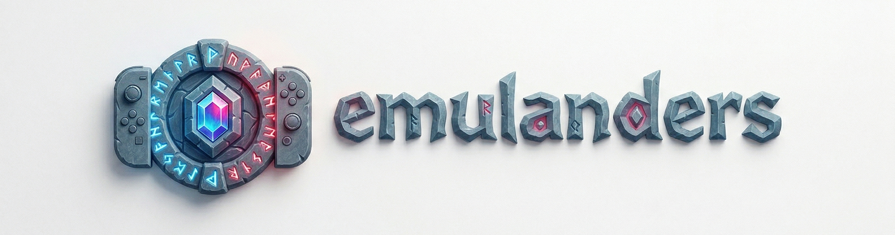
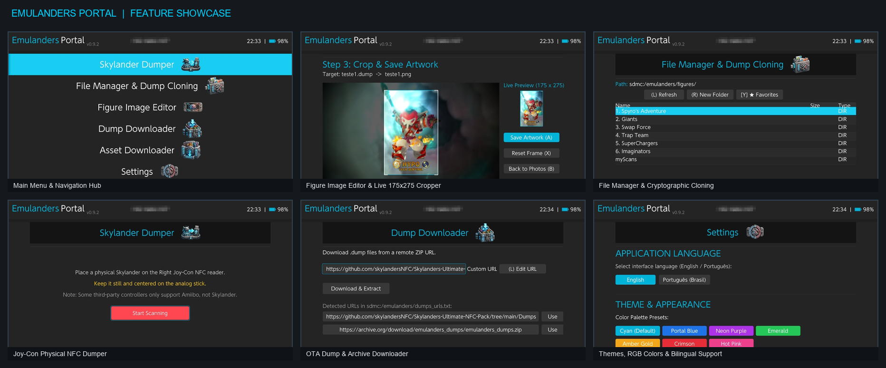
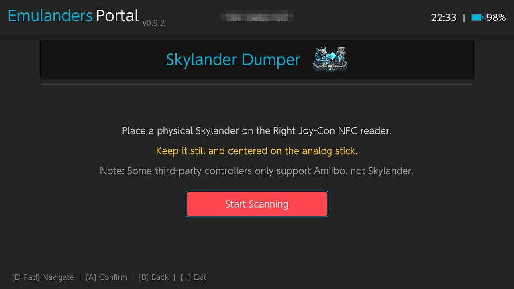
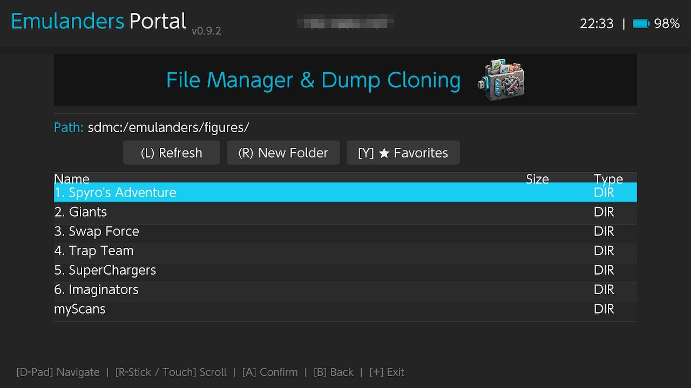
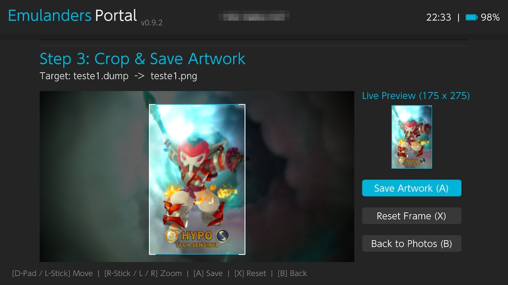
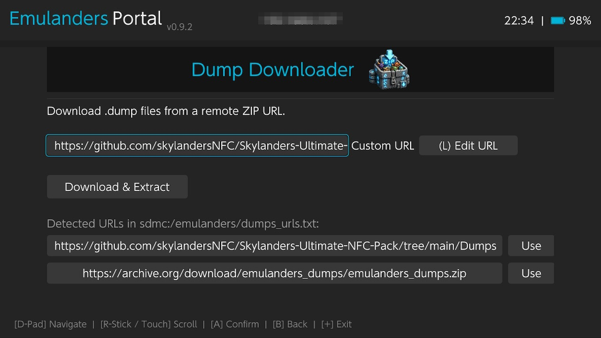
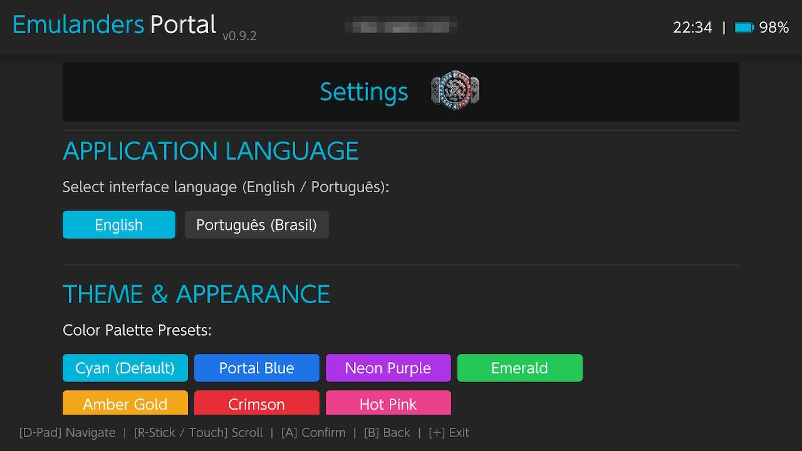

<p align="center">
  
</p>

<p align="center">
  <strong>Emulanders: Skylanders NFC (Mifare) Emulation for Nintendo Switch</strong>
</p>

<p align="center">
  <a title="Release" href="https://github.com/joaohypo/emulanders/releases/latest">
    
  </a>
  <a title="Downloads" href="https://github.com/joaohypo/emulanders/releases">
    
  </a>
  <a title="License" href="https://github.com/joaohypo/emulanders/blob/main/LICENSE">
    
  </a>
</p>

## ⚠️ Disclaimer

**This project is a clean-room reverse engineering effort for educational and archival purposes.**
Emulanders does **not** distribute copyrighted material, encryption keys, Nintendo SDK code, or Skylander game data. Users are expected to provide their own backups (`.dump` or `.bin` files) extracted from physical hardware they legally own.

---

## 📖 Overview

Emulanders is a background sysmodule and Tesla Overlay for the Atmosphère CFW. It enables the loading and hot-swapping of Skylander figures directly from your SD card within *Skylanders: Imaginators*.

Development status and future objectives are documented in the [Project Roadmap](ROADMAP.md).

### Technical Foundation
Standard Nintendo Amiibos utilize NTAG formats via the `nfp` (Nintendo Figurine Platform) service. In contrast, Skylanders hardware relies on NXP Mifare Classic 1K tags. *Skylanders: Imaginators* bypasses the standard Amiibo stack and communicates directly with the low-level **`nfc:mf:u`** (Mifare User) IPC service.

Emulanders acts as a protocol bridge for the `nfc:mf:u` interface, providing a virtualized data path. It intercepts IPC requests and serves figure data from the SD card, ensuring compatibility with the game's official communication standards.

---

## 📥 Download

The latest stable binaries, including the sysmodule (`exefs.nsp`) and the Tesla overlay (`emulanders.ovl`), can be found on the **[Releases Page](https://github.com/joaohypo/emulanders/releases/latest)**. 

Always ensure you are using the version compatible with your current Atmosphère and Firmware setup.

---

## 🚀 Core Features

- **Mifare Protocol Emulation:** Comprehensive implementation of the `nfc:mf:u` service stack.
- **Tesla Overlay:** In-game hot-swapping and mounting of virtual Skylander `.dump` files without leaving *Skylanders: Imaginators*.
- **Physical Joy-Con NFC Dumper (Portal App):** Scan real toys using the Right Joy-Con (`nfp:user`), preview character art, and save 1KB Mifare dumps straight to SD.
- **Cryptographic Cloning Engine:** 1:1 exact duplication and New Identity cloning with UID randomization, sector trailer Key A calculation, Header CRC16 recalculation, data decryption/re-encryption, and Creation Crystal UID conflict safeguards.
- **Interactive Screenshot Cropper:** Direct Switch Album integration, 16:9 previews, Joy-Con D-Pad/stick adjustment, and 1:1 touch cropping to overlay portraits (175x275).
- **OTA Downloaders:** In-app asset pack and figure dump downloaders with real-time extraction.
- **Bilingual Localization:** Complete native support for English and Brazilian Portuguese (PT-BR) with automatic system language detection and runtime switcher.
- **Customizable UI & Themes:** 7 built-in color themes, RGB fine-tuning sliders, and interactive color picker.
- **State Persistence:** Retains emulation state and mounted figures across reboots.
- **Tool Compatibility:** Operates seamlessly alongside Amiibo emulators (e.g., Emuiibo) without service conflict.

---

## ✅ Compatibility

- **Target Game:** Skylanders: Imaginators (Nintendo Switch Version).
- **Firmware Support:** Compatible with Firmware **4.0.0** and higher (due to `nfc:mf:u` requirements).
- **Validated Environment:** Extensively tested on **Firmware 21.2.0** and **Atmosphère 11.1.1** / 1.10.x.

---

## 📂 Installation

### Quick Start (Recommended)
To install Emulanders, simply download **`Emulanders-Bundle-1.0.0.zip`** from the [Releases Page](https://github.com/joaohypo/emulanders/releases/latest) and extract all folders (`atmosphere`, `switch`, `emulanders`) directly to the root of your Switch's SD card.

For figure portraits in the overlay, also download the **Assets Pack** from the releases page and extract it to the root of your SD card — it contains the ready-to-use `emulanders/assets/` structure with portraits for **every Skylander and accessory** across all generations.

### Manual File Placement
Alternatively, you can place the files manually:
- **Sysmodule**: `sd:/atmosphere/contents/420000000000E311/exefs.nsp`
- **Tesla Overlay**: `sd:/switch/.overlays/emulanders.ovl`
- **Standalone App (Emulanders Portal)**: `sd:/switch/EmulandersPortal/EmulandersPortal.nro`
- **Overlay Translations**: `sd:/emulanders/overlay/lang/`

### SD Card Structure
The project utilizes the `sdmc:/emulanders/` directory.

1. **`/figures/`**: Place raw `.dump` or `.bin` backups here. Subfolders are supported and recommended for organization (e.g., by Element or Series).
   *Example:* `sd:/emulanders/figures/Senseis/King_Pen.dump`
2. **`/assets/`**: *(Optional)* Shared portrait images, resolved automatically by Character ID. See **Image Resolution** below.
3. **`/overlay/lang/`**: Language definition files (JSON).
4. **`/flags/`**: System-managed files for state persistence.

---

## 🎮 Usage

<div align="center">
  <video src="https://github.com/user-attachments/assets/7e61b20a-e117-4c3a-9585-9310cc56cbc0" autoplay="autoplay" loop="loop" muted="muted" playsinline width="480"></video>
  <br>
  <em><a href="https://youtu.be/oYJi1xWd5xI">Watch the full Usage Demonstration on YouTube</a></em>
</div>

### ⚠️ Important Prerequisites
- **Sysmodule Status:** Ensure the Emulanders sysmodule is running in the background. If you use tools like **Hekate Toolbox** (homebrew app) or the **Sysmodules** overlay (Tesla/Ultrahand) to toggle background modules ON/OFF, **you must restart your console** for the changes to take effect.
- **Enable Before Launch:** Emulation **must be set to ON** in the Emulanders Tesla menu *before* you start the game. *Skylanders: Imaginators* initializes its NFC services during the loading screen. If emulation is off when the game boots, the sysmodule will miss the initial IPC calls and will not intercept the game.

### Basic Workflow
1. Open the Tesla menu (**L + D-Pad Down + Right Stick Click**).
2. Select **emulanders**.
3. Set **Emulation** to **ON**.
4. **Important:** Minimize the overlay and launch the game. It is highly recommended to only re-open the overlay once you are inside the game world, **after all initial loading screens have finished**. The game's loading process is extremely resource-intensive and may cause lag or instability in the overlay interface if used simultaneously.
5. Navigate to **View Figures Folder** and select a file (`.dump` or `.bin`).
6. The `>> ACTIVE` indicator confirms the figure is mounted.
7. **To swap:** Select a different file.
8. **To unmount:** Select the active file again, use the **Clear active Skylander** menu option, or press the **X** button while the overlay is open.

### Commands
- **Enable Emulation:** `[ZR]`
- **Disable Emulation:** `[ZL]`
- **Select Skylander / Folder:** `[A]`
- **Toggle Favorite:** `[Y]`
- **Clear active Skylander:** `[X]`
- **Show Help:** `[+]` (Plus)

### Technical Notes
- **Polling Overhead:** To reduce CPU usage after a character has loaded, it is recommended to unmount the figure. This suspends the high-frequency IPC polling.
- **Swap Force:** *Skylanders: Imaginators* on Switch provides full compatibility for Swap Force figures. However, because the game itself does not implement the "part-mixing" mechanic on this platform, you only need to select a single backup file (either the base or the top half) to load the character in its entirety.

### 🖼️ Image Resolution

The overlay displays a portrait for each figure using a **3-tier fallback** system. No manual configuration is required — the overlay reads the Character ID and Variant ID directly from the dump file.

| Priority | Path Pattern | Example |
|:--|:--|:--|
| 1. **Same-name PNG** | `<figure_path_without_ext>.png` | `figures/King_Pen.png` (beside `King_Pen.dump`) |
| 2. **Shared asset (variant)** | `assets/{CharID}_{VariantID}.png` | `assets/000259_5000.png` |
| 3. **Shared asset (base)** | `assets/{CharID}.png` | `assets/000259.png` |

**How it works:** When no same-name PNG is found, the overlay reads bytes `16-18` (Character ID) and `28-29` (Variant ID) from the `.dump` / `.bin` file, then looks for a matching image in `sd:/emulanders/assets/`.

An **Assets Pack** is available as a separate download on the [Releases Page](https://github.com/joaohypo/emulanders/releases). It includes portraits for **every known Skylander figure, variant, and accessory**. To install, simply extract the zip to the **root of your SD card** — the folder structure is ready to go. Recommended image resolution: **RGBA PNG, ≤200×275px**.

---

## 🌟 Emulanders Portal (Standalone App Guide)

<p align="center">
  
</p>

**Emulanders Portal** is the companion homebrew application for managing your collection directly on the Nintendo Switch without needing a PC. Launch it from the **Homebrew Menu** (`hbmenu`).

```
sd:/switch/EmulandersPortal/EmulandersPortal.nro
```

### 1. Physical Joy-Con NFC Dumper

<p align="center">
  
</p>

Back up your physical Skylander toys directly using your Nintendo Switch hardware:
- **How to use:** Navigate to the **Dump Figure** tab and place your physical toy onto the Right Joy-Con analog stick (or the NFC contact point on a Nintendo Switch Pro Controller).
- **Automated Detection:** The app utilizes the low-level `nfp:user` service to read the Mifare Classic 1K tag, identifies the Character ID and Variant ID, and immediately displays the official portrait art and character details.
- **One-Click Backup:** Press **[A]** to save a clean 1KB Mifare dump (`.dump`) directly into `sdmc:/emulanders/figures/`.

### 2. File Manager & Cryptographic Cloning Engine

<p align="center">
  
</p>

Manage your library and create duplicate figures with custom identities:
- **File Browser:** Browse folders, view high-resolution figure previews, organize directories, delete old dumps, and mark figures as **Favorites** for quick access in the Tesla overlay.
- **1:1 Exact Duplication:** Duplicates the dump file byte-for-byte. Perfect for simple backups.
- **New Identity Duplication:**
  - Generates a completely new randomized 4-byte Mifare UID.
  - Recomputes the Sector 0 BCC (Block Check Character) checksum.
  - Derives all 16 Mifare Sector Trailer Key A values using the Mifare cryptographic key derivation algorithm.
  - Decrypts the figure data blocks with the old UID, re-encrypts them under the new UID keys, and recalculates the Sector 0 Block 1 Header CRC16 checksum.
  - *Why this matters:* The game rejects two figures on the portal with identical UIDs. New Identity cloning allows you to run multiple instances of the same figure simultaneously or reset/level up duplicate Creation Crystals without conflicts!

### 3. Figure Image Editor & Album Cropper

<p align="center">
  
</p>

Personalize any figure's portrait directly from your console screenshots:
- **Album Integration:** Opens your Nintendo Switch Screenshot Album (`sdmc:/Nintendo/Album/`, including emuMMC paths) or any custom folder with PNG/JPG images.
- **Interactive Cropping Tool:**
  - View full 16:9 screenshots on screen.
  - Adjust the crop window using the **D-Pad / Left Stick** or drag directly via the **Touchscreen**.
  - Zoom and scale with the **Right Stick / Shoulder Buttons**.
  - Save the cropped 175×275 portrait alongside the dump (`figure.png`), instantly updating thumbnails across both Emulanders Portal and the Tesla overlay.

### 4. Over-The-Air (OTA) Downloaders

<p align="center">
  
</p>

- **Asset Pack Downloader:** Download and extract the full community portrait asset collection directly to `sdmc:/emulanders/assets/` over Wi-Fi.
- **Figure Dumps Downloader:** Pull figure archives and packs directly from remote repositories onto your SD card without needing an FTP client or SD card reader.

### 5. Custom Themes & Accessibility

<p align="center">
  
</p>

- **Color Themes:** Choose between 7 pre-configured color palettes (Emulanders Blue, Portal Purple, Magma Red, Life Green, Tech Orange, Undead Violet, Dark Void) or design your own with the RGB sliders and color palette picker.
- **Bilingual Localization:** Fully translated into **English** and **Português (Brasil)** with automatic system language detection and on-the-fly toggling.
- **Docked & Handheld Navigation:** Full support for Joy-Cons, Pro Controllers, and capacitive multi-touch gestures.

---

## ⚠️ Known Issues

### Docked Mode UI Disappearance
In **Docked Mode**, if the Nintendo Switch's **"Adjust Screen Size"** setting is set to less than **100%**, the main Emulanders UI window may disappear when selected from the Tesla menu (though the Tesla base menu itself remains functional). This is a known system-level compositing conflict with overscan rescaling.

**Workaround:** Set your Switch's **Adjust Screen Size** to **100%** (**System Settings > TV Settings > Adjust Screen Size**). If the image cuts off on your TV, adjust the "Overscan" or "Aspect Ratio" settings on your **TV itself** (e.g., set to "Just Scan" or "1:1 Pixel Mapping").

---

## 🤝 Coexistence
Emulanders and Emuiibo target different logical interfaces (`nfc:mf:u` and `nfp`, respectively). They can be installed and used simultaneously without service-level conflicts.

---

## 🐛 Debugging
If a specific dump fails to load:
1. Open the overlay and enter the **Logs Manager**.
2. Enable **Debug Logging**.
3. Reproduce the error in-game.
4. Select **Extract to SD** to save the buffer to `sdmc:/emulanders/debug_log_dump.txt`.
5. Attach the log when opening an issue.

---

## 🛠️ Compilation
Requires the [Switch Rust Toolchain](https://github.com/aarch64-switch-rs/setup-guide) and devkitPro (devkitA64).
Run `make dist` for release builds or `make dist-dev` for debug builds.

---

## ❤️ Credits & Acknowledgments

**The primary credit for this project belongs to XorTroll and the incredible contributors of the Emuiibo project.**
Emulanders is built upon the foundational research, sysmodule architecture, and UI logic originally developed for Emuiibo. While this software has been fully refactored to specialize in the `nfc:mf:u` service for Skylanders, its existence is a direct result of the brilliant work and open-source spirit of XorTroll and everyone who collaborated on the original Amiibo emulation system.

Special thanks to:
- [**XorTroll**](https://github.com/XorTroll): For the original Emuiibo project, sysmodule framework, and continuous inspiration to the Switch homebrew scene.
- **Emuiibo Contributors**: *Subv, ogniK, averne, spx01, SciresM* and everyone involved in the original **nfp-mitm** research.
- **Overlay Devs**: *AD2076* and *AmonRaNet* for their essential work on the Tesla overlay framework.
- [**Switchbrew**](https://switchbrew.org/): For the peerless technical documentation that makes all Switch homebrew possible.
- [**nx (aarch64-switch-rs)**](https://github.com/aarch64-switch-rs/nx): For the native Rust bindings.
- [**SkylandersNFC**](https://github.com/skylandersNFC): For the deep-dive research into Mifare figure structures.

Finally, a massive thank you to the **Skylanders community** for their tireless passion in building tools, creating tutorials, and keeping the magic of the game alive for future generations.

---

## 📜 License

Emulanders is licensed under **GNU GPLv3**. 

By adopting **GPLv3**, we ensure that the project remains open and protected against "Tivoization" (blocking users from running modified versions on their hardware) and provides stronger patent protections. This is an established standard for preserving freedom in modern console homebrew. 

See the [**LICENSE**](LICENSE) file for full details.

*Ryujinx project exemption: The Ryujinx team is exempt from GPLv3 licensing for this codebase.*