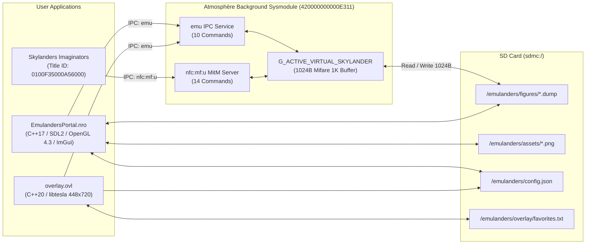

# Architecture & System Topology

See also: [`wiki/index.md`](index.md) | [`wiki/nfc-ipc-protocol.md`](nfc-ipc-protocol.md) | [`wiki/mifare-crypto-spec.md`](mifare-crypto-spec.md)

---

## 1. Three-Component Topology

Emulanders is divided into three distinct binaries designed around Horizon OS process and memory constraints:



---

## 2. Component Specifications & Memory Budgets

### 2.1 Background Sysmodule (`emulanders`)
- **Language / Framework:** `#![no_std]` Rust using the [`nx`](https://github.com/aarch64-switch-rs/nx) library (`emulanders/src/`).
- **Program ID:** `0x420000000000E311` (`atmosphere/contents/420000000000E311/exefs.nsp`).
- **Heap Budget:** `0x6C000` (`442,368` bytes / `432 KB`) allocated via `__nx_rrt0_initialize_heap` in [`emulanders/src/main.rs`](../emulanders/src/main.rs#L22-L26).
- **Stack Size:** `0x4000` (`16 KB`).
- **Pointer Buffer Size:** `0x1000` (`4 KB`) for IPC Hipc pointer descriptors.
- **Responsibilities:**
  1. Hosts the custom `emu` IPC service (max 30 sessions) for control by the Tesla Overlay and Emulanders Portal.
  2. Registers an Atmosphère `sm:manager` MitM hook on **`nfc:mf:u`** only when `EmulationStatus == On`.
  3. Holds the active 1024-byte Mifare 1K virtual tag in `G_ACTIVE_VIRTUAL_SKYLANDER` and flushes game write-backs (`WriteMifare`, Command `[8]`) directly to the `.dump` file on the SD card.

### 2.2 In-Game Tesla Overlay (`overlay`)
- **Language / Framework:** C++20 with `libtesla` (`overlay/source/main.cpp`).
- **Binary Location:** `sdmc:/switch/.overlays/emulanders.ovl`.
- **Framebuffer Constraints:** Renders into a `448 × 720` layer surface managed by `nx-ovlloader`.
- **Responsibilities:**
  1. Toggles `EmulationStatus` (`On` / `Off`) in real time while *Skylanders Imaginators* is running.
  2. Mounts and hot-swaps `.dump` figures into the virtual portal (`emu::TryOpenVirtualSkylander`) and clears the portal (`emu::CloseActiveVirtualSkylander`).
  3. Renders `175 × 275` figure portraits (`RGBA8888` scaled to `RGBA4444` in `libtesla`) and manages the favorites list (`sdmc:/emulanders/overlay/favorites.txt`).
  4. Displays a live IPC debug log drawer when diagnostic logging is enabled.

### 2.3 Emulanders Portal Application (`EmulandersPortal`)
- **Language / Framework:** C++17, `libnx`, `SDL2`, `OpenGL 4.3 Core` (`glad`), `Dear ImGui 1.92.6`, `libcurl`, `minizip` (`EmulandersPortal/source/`).
- **Binary Location:** `sdmc:/switch/EmulandersPortal/EmulandersPortal.nro`.
- **Responsibilities:**
  1. **Physical Skylander Dumper:** Temporarily pauses `emulanders` emulation (`EmulationStatus::Off`), opens the real Joy-Con/Pro Controller `nfc:mf:u` hardware handle, derives all 16 sector keys via `Runes::CalcKeyA(uid, sector)`, reads all 64 blocks, identifies the character/variant via [`skylanders_db.hpp`](../EmulandersPortal/source/skylanders_db.hpp), and writes the `1024`-byte `.dump`.
  2. **File Manager & Collection Inspector:** Browses folders and favorites, decodes encrypted Mifare blocks in memory via `SkylanderFigure` (`crypto/skylander_crypt.cpp`), displays Hero Stats (XP, Gold, Heroic Challenges, Nickname, Owner ID), and performs safe surgical repairs (Reset Figure to Level 1, Reset Crystal, Clear Owner ID, Maximize Gold/XP).
  3. **Custom Artwork Studio:** Crops Switch screenshots (`sdmc:/Nintendo/Album/`) or custom images to `175 × 275` `.png` files saved next to `.dump` files.
  4. **OTA Downloaders:** Downloads and extracts figure packs and the community `175 × 275` asset pack (`emulanders_assets_pack.zip`).

---

## 3. Custom `emu` IPC Service Contract

Defined in [`emulanders/src/emu.rs`](../emulanders/src/emu.rs) and consumed by [`overlay/include/emu_Service.hpp`](../overlay/include/emu_Service.hpp) and [`EmulandersPortal/source/emu_Service.cpp`](../EmulandersPortal/source/emu_Service.cpp):

| Command ID | Method | Inputs | Outputs | Description |
| :---: | :--- | :--- | :--- | :--- |
| `0` | `get_version` | None | `Version` (`u8 major, u8 minor, u8 micro, u8 dev_build`) | Returns sysmodule version (`1.0.0.0`) for compatibility verification. |
| `1` | `get_virtual_skylander_directory` | `OutBuffer<char>` | Directory path | Returns `sdmc:/emulanders/figures`. |
| `2` | `get_emulation_status` | None | `EmulationStatus` (`u32`: `0=On`, `1=Off`) | Queries whether `nfc:mf:u` MitM interception is active. |
| `3` | `set_emulation_status` | `EmulationStatus` (`u32`) | None | Enables or disables `nfc:mf:u` MitM interception and updates `/emulanders/flags/status_on`. |
| `4` | `get_active_virtual_skylander` | `OutBuffer<char>` | `VirtualSkylanderData` (`uid[10]`, `bcc[2]`) | Returns metadata and file path of the currently mounted figure (or `ResultSkylanderNotLoaded` = `0x149A02`). |
| `5` | `try_open_virtual_skylander` | `InBuffer<char>` (Path) | `VirtualSkylanderData` | Reads a 1024-byte `.dump` from SD, mounts it in `G_ACTIVE_VIRTUAL_SKYLANDER`, and fires `G_TAG_DISCOVERY_EVENT`. |
| `6` | `close_active_virtual_skylander` | None | None | Unmounts the active figure and signals `G_DEACTIVATE_EVENT` to the game. |
| `7` | `get_debug_log` | `OutBuffer<char>` | UTF-8 string | Copies the in-memory ring buffer `G_DEBUG_LOG` (up to 16 KB). |
| `8` | `clear_debug_log` | None | None | Clears `G_DEBUG_LOG`. |
| `9` | `get_logging_status` | None | `bool` | Returns whether diagnostic IPC logging is active. |
| `10` | `set_logging_status` | `bool` | None | Enables or disables diagnostic IPC logging. |

---

## 4. SD Card Filesystem Contract

All runtime data is isolated under `sdmc:/emulanders/`:

```text
sdmc:/
├── atmosphere/
│   └── contents/
│       └── 420000000000E311/
│           ├── exefs.nsp                        # Rust sysmodule executable
│           ├── toolbox.json                     # Hekate / Kosmos Toolbox metadata
│           └── flags/
│               └── boot2.flag                   # Auto-start sysmodule at Horizon boot
├── switch/
│   ├── .overlays/
│   │   └── emulanders.ovl                       # In-game Tesla Overlay binary
│   └── EmulandersPortal/
│       └── EmulandersPortal.nro                 # Standalone Portal Manager binary
└── emulanders/
    ├── config.json                              # Shared settings (theme accent RGB + "language")
    ├── dumps_urls.txt                           # Optional list of custom ZIP URLs for OTA downloader
    ├── assets/                                  # Community portrait pack (<CharID>.png, <CharID>_<VarID>.png)
    ├── figures/                                 # Root directory scanned by Overlay and Portal
    │   ├── Scans/                               # Physical figures dumped via Right Joy-Con NFC
    │   └── Downloads/                           # Figures extracted via OTA Dump Downloader
    ├── flags/
    │   └── status_on                            # Presence indicates EmulationStatus::On across reboots
    └── overlay/
        ├── favorites.txt                        # Newline-delimited SD paths of starred figures
        └── lang/                                # Localization JSONs (en.json, pt-BR.json, es.json, etc.)
```
