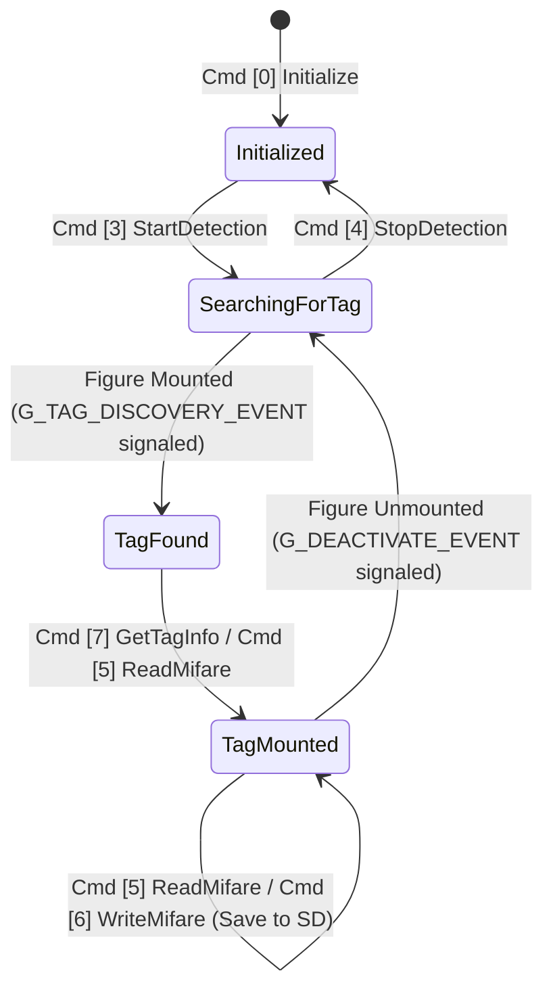

# Horizon OS `nfc:mf:u` IPC Protocol Specification

See also: [`wiki/index.md`](index.md) | [`wiki/architecture.md`](architecture.md) | [`wiki/mifare-crypto-spec.md`](mifare-crypto-spec.md)

---

## 1. Service Overview & Emuiibo Coexistence

Nintendo Switch games communicate with Joy-Con and Pro Controller NFC readers through three distinct Horizon OS services depending on tag technology:

| Service Name | Tag Standard | Primary Games | Intercepted By |
| :--- | :--- | :--- | :--- |
| `nfp:user` | NTAG215 (Amiibo) | *Zelda: BotW/TotK*, *Super Smash Bros. Ultimate*, *Splatoon* | `emuiibo` |
| `nfc:am:u` | Amiibo raw NFC | System Settings Amiibo applet | `emuiibo` |
| **`nfc:mf:u`** | **Mifare Classic 1K** | ***Skylanders Imaginators*** (`0100F35000A56000`) | **`emulanders`** |

Because `emulanders` registers its Atmosphère `sm:manager` MitM hook exclusively on **`nfc:mf:u`** (in [`emulanders/src/main.rs`](../emulanders/src/main.rs#L65-L83)), it has zero overlap with `emuiibo`. Both sysmodules can run simultaneously on the same console.

Furthermore, when `EmulationStatus` is set to `Off` (via the Tesla Overlay or automatically when entering the Emulanders Portal physical scanner), `mitm_filter` returns `true` (passthrough), forwarding `nfc:mf:u` sessions directly to Nintendo's native NFC driver so physical figures can be read on the Right Joy-Con.

---

## 2. `IUserManager` Interface (`nfc:mf:u` Root Session)

Implemented in [`emulanders/src/mifare.rs`](../emulanders/src/mifare.rs):

| Command ID | Method | Signature | Behavior |
| :---: | :--- | :--- | :--- |
| `0` | `CreateUserInterface` | `() -> OutSession<IUser>` | Creates and returns a sub-session implementing the 14-command `IUser` Mifare interface. |

---

## 3. `IUser` Interface (14 Commands `[0..13]`)

Implemented in [`emulanders/src/mifare.rs`](../emulanders/src/mifare.rs#L170-L435). Every command expected by *Skylanders Imaginators* is listed below:

| Cmd ID | Method Name | Inputs | Outputs | Implementation Details |
| :---: | :--- | :--- | :--- | :--- |
| **`0`** | `Initialize` | `u64 aruid, u64 zero, InMapAliasBuffer<u8>` | None | Transitions session state to `State::Initialized` (`1`) and resets `DeviceState`. |
| **`1`** | `Finalize` | None | None | Transitions session state back to `State::NonInitialized` (`0`). |
| **`2`** | `ListDevices` | `OutPointerBuffer<DeviceHandle>` | `u32 count` | Writes a virtual `DeviceHandle` (`0x00000001` — Player 1 controller) and returns `count = 1`. |
| **`3`** | `StartDetection` | `DeviceHandle` | None | Transitions device state to `SearchingForTag` (or immediately signals `G_TAG_DISCOVERY_EVENT` if a virtual Skylander is already mounted in `G_ACTIVE_VIRTUAL_SKYLANDER`). |
| **`4`** | `StopDetection` | `DeviceHandle` | None | Transitions device state to `Initialized` (`0`). |
| **`5`** | `ReadMifare` | `DeviceHandle, InMapAliasBuffer<MifareReadBlockParameter>` | `OutMapAliasBuffer<MifareReadBlockData>` | Reads requested 16-byte blocks (`sector_number = block_idx`, `0..63`) from `G_ACTIVE_VIRTUAL_SKYLANDER`. For Sector Trailer blocks (`block_idx % 4 == 3`), zeroes `Key A` (`bytes 0..5`) and `Key B` (`bytes 10..15`) while returning access bits (`0x7F 0x0F 0x08 0x69`), matching real NXP Mifare hardware read behavior. |
| **`6`** | `WriteMifare` | `DeviceHandle, InMapAliasBuffer<MifareWriteBlockParameter>` | None | Writes 16-byte blocks into `G_ACTIVE_VIRTUAL_SKYLANDER` and immediately flushes the updated 1024-byte buffer to the `.dump` file on SD card (`skylander.save()`). |
| **`7`** | `GetTagInfo` | `DeviceHandle` | `OutFixedPointerBuffer<TagInfo>` | Populates a `0x58`-byte `TagInfo` struct: `uuid_length = 4` (standard 4-byte NUID), `protocol = 1` (`TypeA`), `tag_type = 1 << 6` (`Mifare` = `0x40`), and copies the figure's UID bytes. |
| **`8`** | `AttachActivateEvent` | `DeviceHandle` | `CopyHandle<KEvent>` | Returns a copy handle to `G_TAG_DISCOVERY_EVENT` (auto-clear = `false`), signaled whenever a virtual Skylander is mounted. |
| **`9`** | `AttachDeactivateEvent` | `DeviceHandle` | `CopyHandle<KEvent>` | Returns a copy handle to `G_DEACTIVATE_EVENT` (auto-clear = `false`), signaled when the user clears/unmounts the active figure. |
| **`10`** | `GetState` | None | `u32 State` | Returns `0` (`NonInitialized`) or `1` (`Initialized`). |
| **`11`** | `GetDeviceState` | `DeviceHandle` | `u32 DeviceState` | Returns the current `DeviceState` (`0 = Initialized`, `1 = SearchingForTag`, `2 = TagFound`, `4 = TagMounted`, `5 = TagRemoved`). |
| **`12`** | `GetNpadId` | `DeviceHandle` | `u32 NpadId` | Returns `0x00` (`NpadIdType_No1`) or `0x20` (`NpadIdType_Handheld`). |
| **`13`** | `AttachAvailabilityChangeEvent` | None | `CopyHandle<KEvent>` | Returns a copy handle to `G_AVAILABILITY_CHANGE_EVENT`. |

---

## 4. Virtual Portal State Machine & Hot-Swapping

### Hot-Swap Sequence (Switching Figures In-Game)
When the player selects a new figure in the Tesla Overlay while *Skylanders Imaginators*already has a figure mounted:
1. If a previous figure was loaded in `G_ACTIVE_VIRTUAL_SKYLANDER`, the sysmodule signals `G_DEACTIVATE_EVENT` so the game cleanly unmounts the first character from the in-game portal.
2. The new `.dump` file is loaded into `G_ACTIVE_VIRTUAL_SKYLANDER`.
3. `G_TAG_DISCOVERY_EVENT` is signaled, prompting the game to call `GetDeviceState` (`TagFound`), `GetTagInfo`, and `ReadMifare` to summon the new character.
